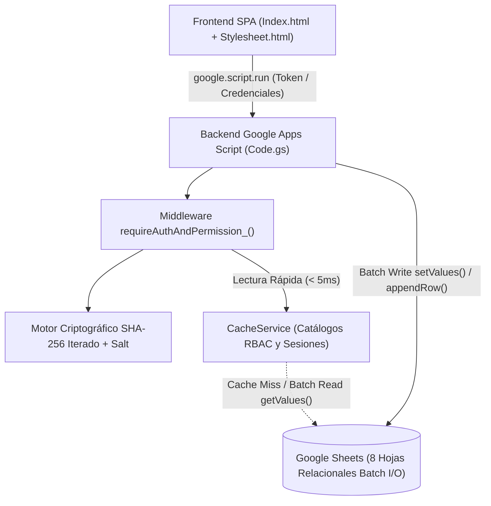
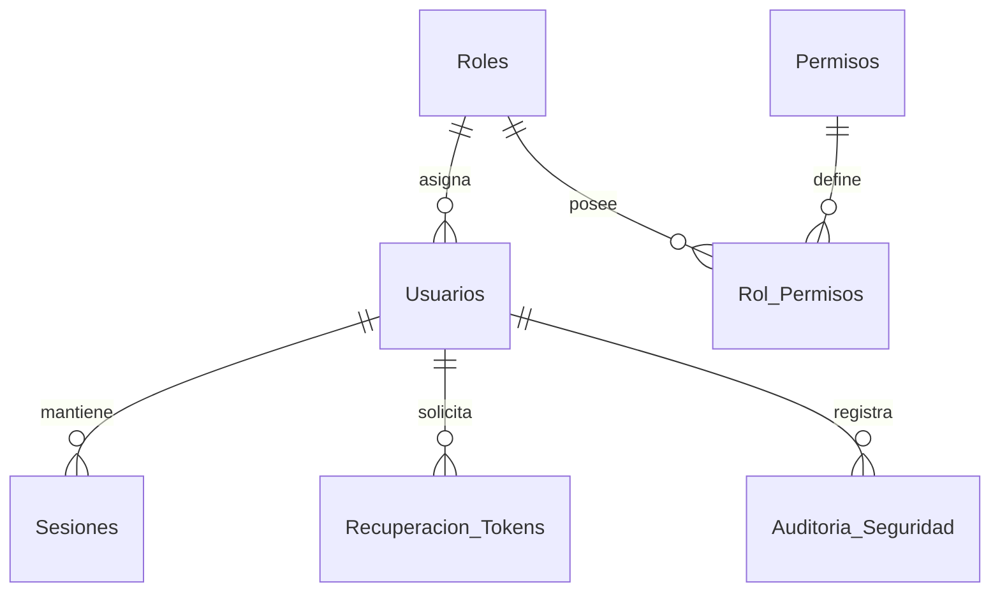

# Ficha Técnica: Sistema Web Empresarial — Core Auth, Usuarios & RBAC (IA + Google Sheets)

> **Desarrollador Líder:** Rogerr Carvajal ([@rogerrcarvajal](https://github.com/rogerrcarvajal))  
> **Especialidad:** Arquitectura de Software con Modelos y Agentes Inteligentes  
> **Versión:** 1.0.0  
> **Estado:** Producción  
> **Tecnologías:** Google Apps Script (V8 Runtime), Google Sheets (Batch I/O + CacheService), HTML5, CSS3 (Quantum Dark Glassmorphism), Vanilla JavaScript ES6+  
> **Referencia Base:** [Guía de Arquitectura en YouTube](https://www.youtube.com/watch?v=EsF9s0goD0w)

---

## 1. Resumen Técnico

El **Sistema Web Empresarial — Core Auth & RBAC** es una arquitectura base moderna, segura, responsive y reutilizable diseñada para gestionar **Autenticación**, **Autorización Basada en Roles y Permisos (RBAC)**, **Sesiones con Expiración** y **Auditoría Zero-Trust** utilizando **Google Apps Script** como backend serverless y **Google Sheets** como motor de persistencia relacional optimizado.

Esta plataforma está diseñada para integrarse de forma inmediata como núcleo de seguridad en aplicaciones empresariales de:
- 📦 **Sistemas de Inventario y Almacenes** (`INVENTARIO_ACCESS`)
- 💳 **Sistemas de Ventas y Facturación** (`VENTAS_ACCESS`)
- 🚚 **Sistemas de Logística y Despacho** (`LOGISTICA_ACCESS`)
- 🦺 **Plataformas de Gestión SSOMA — Seguridad, Salud Ocupacional y Medio Ambiente** (`SSOMA_ACCESS`)

---

## 2. Arquitectura del Sistema y Flujo Zero-Trust

### 2.1. Diferencia entre Autenticación y Autorización
- **Autenticación (*¿Quién eres?*):** Verifica la identidad del usuario validando su correo y contraseña contra el hash criptográfico derivado con Salt único (`SHA-256` iterado 1,500 rondas + Pepper) en tiempo constante (`constantTimeEquals_`), emitiendo un token de sesión aleatorio cuyo hash se registra en la hoja `Sesiones`.
- **Autorización (*¿Qué tienes permiso de hacer?*):** En cada llamada RPC al servidor, el middleware `requireAuthAndPermission_(rawToken, requiredPermission)` valida que la sesión esté activa, que no haya expirado y que el rol del usuario posea el permiso específico requerido en la matriz `Rol_Permisos`.

---

## 3. Estructura de Archivos (3 Archivos Modulares)

| Archivo | Rol Arquitectónico | Descripción Técnica |
|---|---|---|
| [`Code.gs`](./Code.gs) | Backend Serverless + DB Provisioner | Contiene `doGet()`, aprovisionamiento automático `setupDatabase()`, motor criptográfico con Salt/Hash, control de sesiones, caché multicapa y API RPC protegida por permisos. |
| [`Stylesheet.html`](./Stylesheet.html) | Sistema de Diseño UI | Tokens CSS en modo oscuro cuántico (`#0b0f19`), tarjetas `.card-glass` con `backdrop-filter: blur(14px)`, gradientes cyan/índigo y grillas adaptables. |
| [`Index.html`](./Index.html) | Frontend SPA Reactivo | Vistas de Login, Auto-Registro configurable, Recuperación de contraseña por correo (OTP), Dashboard, Gestión de Usuarios, Matriz RBAC, Perfil, Bitácora de Auditoría y Conectores Empresariales. |

---

## 4. Ficha de Endpoints RPC (Servidor Apps Script)

| Función RPC (`Code.gs`) | Permiso Requerido | Parámetros de Entrada | Respuesta Sanitizada |
|---|---|---|---|
| `setupDatabase()` | Ejecución Editor / Auto | Ninguno | Crea automáticamente las 8 hojas, cabeceras con estilo y datos semilla. |
| `apiGetBootstrapState(token)` | Público / Sesión opcional | `sessionToken` | Configuración pública y estado de sesión actual sin exponer hashes. |
| `apiLogin(payload)` | Público (con Rate Limit) | `{ email, password }` | `{ success, sessionToken, expiresAt, user, catalogs }` |
| `apiLogout(sessionToken)` | Sesión activa | `sessionToken` | Invalida sesión en hoja `Sesiones` y limpia `CacheService`. |
| `apiRegisterPublicUser(payload)` | Público (si Admin lo activa) | `{ nombre_completo, email, password }` | Crea usuario con rol por defecto sin revelar si el correo existía. |
| `apiRequestPasswordReset(email)` | Público (con Rate Limit) | `email` | Genera código OTP de 15 min, guarda su hash y lo envía vía `MailApp`. |
| `apiConfirmPasswordReset(payload)` | Público (con OTP válido) | `{ email, code, newPassword }` | Valida hash del OTP, regenera Salt + Hash y desbloquea la cuenta. |
| `apiUpdateOwnProfile(token, data)` | Sesión activa | `{ nombre_completo, currentPassword, newPassword }` | Actualiza nombre o contraseña verificando la clave actual. |
| `apiGetAdminDashboardData(token)` | `DASHBOARD_VIEW` | `sessionToken` | Métricas operativas, usuarios sanitizados, roles, permisos y auditoría. |
| `apiAdminSaveUser(token, user)` | `USERS_MANAGE` | `{ id_usuario, nombre_completo, email, rol_id, estado, password }` | Crea o actualiza usuarios y restablece bloqueos en una sola escritura por lotes. |
| `apiAdminUpdateRolePermissions` | `ROLES_MANAGE` | `{ id_rol, permisos[] }` | Reescribe en bloque la matriz `Rol_Permisos` y limpia la caché. |
| `apiAdminUpdateSettings(token, cfg)` | `ROLES_MANAGE` | `{ ALLOW_PUBLIC_REGISTRATION, SESSION_TTL_MINUTES, MAX_LOGIN_ATTEMPTS }` | Actualiza políticas globales de seguridad en `Configuracion`. |
| `apiExecuteProtectedModuleAction` | `*_ACCESS` según módulo | `(sessionToken, moduleKey)` | Verifica permiso en servidor para `INVENTARIO`, `VENTAS`, `LOGISTICA` o `SSOMA`. |

---

## 5. Esquema de Base de Datos en Google Sheets (Creado Automáticamente)

Al ejecutar `setupDatabase()` (o al abrir la aplicación web por primera vez), el sistema construye automáticamente **8 hojas** con sus respectivas columnas:

1. **`Usuarios`**: `id_usuario`, `nombre_completo`, `email`, `rol_id`, `password_hash`, `password_salt`, `estado`, `intentos_fallidos`, `bloqueado_hasta`, `ultimo_acceso`, `creado_en`, `actualizado_en`.
2. **`Roles`**: `id_rol`, `nombre_rol`, `descripcion`, `nivel_jerarquia`, `estado`.
3. **`Permisos`**: `id_permiso`, `codigo_permiso`, `modulo`, `descripcion`.
4. **`Rol_Permisos`**: `id_asignacion`, `id_rol`, `codigo_permiso`, `asignado_en`.
5. **`Sesiones`**: `token_hash`, `id_usuario`, `email`, `rol_id`, `ip_context`, `creado_en`, `expira_en`, `activo`.
6. **`Recuperacion_Tokens`**: `token_hash`, `id_usuario`, `email`, `creado_en`, `expira_en`, `usado`.
7. **`Auditoria_Seguridad`**: `id_evento`, `timestamp`, `id_usuario`, `email`, `evento`, `modulo`, `resultado`, `detalle`.
8. **`Configuracion`**: `clave', `valor`, `descripcion`, `actualizado_en`.

---

## 6. Medidas de Seguridad y Rendimiento Implementadas

- **Cero Contraseñas en Texto Plano:** Cada contraseña genera un `Salt` aleatorio único de 64 caracteres hexadecimales y se procesa con 1,500 iteraciones de `SHA-256` más un `Pepper` de servidor.
- **Prevención de Enumeración de Cuentas:** Ni el login, ni el registro público, ni el flujo de recuperación de contraseña revelan si un correo electrónico está registrado en la base de datos.
- **Protección contra Fuerza Bruta y Rate Limiting:** Control de frecuencia mediante `CacheService` y bloqueo automático de cuenta (`bloqueado_hasta`) tras superar el límite configurable de intentos fallidos.
- **Sanitización Estricta de Salida:** La función `sanitizeUserForClient_()` garantiza que `password_hash`, `password_salt` y `token_hash` jamás viajen al navegador.
- **Operaciones por Lotes (Batch I/O):** Lecturas completas de tabla en una sola llamada `getRange().getValues()` y escrituras por fila completa o matriz mediante `setValues()`, eliminando lecturas/escrituras celda por celda.

---

## 7. Instrucciones de Instalación y Despliegue en Google Apps Script

1. **Crear el Google Sheet:**
   - Crea una nueva hoja de cálculo en [Google Sheets](https://sheets.new).
   - Ve al menú superior **Extensiones > Apps Script**.
2. **Cargar los 3 Archivos del Proyecto:**
   - Reemplaza el contenido de `Código.gs` (o `Code.gs`) con el código de [`Code.gs`](./Code.gs).
   - Crea un archivo HTML llamado `Stylesheet` (Apps Script añadirá `.html`) y pega el contenido de [`Stylesheet.html`](./Stylesheet.html).
   - Crea un archivo HTML llamado `Index` y pega el contenido de [`Index.html`](./Index.html).
3. **Inicializar las Hojas y Columnas Automáticamente:**
   - En la barra superior del editor de Apps Script, selecciona la función `setupDatabase` y haz clic en **Ejecutar (Run)**.
   - Autoriza los permisos de la cuenta cuando Google lo solicite. Se crearán las 8 hojas con datos semilla.
4. **Publicar como Aplicación Web:**
   - Haz clic en **Implementar > Nueva implementación**.
   - Selecciona el tipo **Aplicación web**.
   - En *Ejecutar como*, elige **Yo**.
   - En *Quién tiene acceso*, selecciona **Cualquier usuario** (el control de acceso real lo gestiona el módulo Zero-Trust).
   - Copia la URL de la aplicación web y accede con las credenciales iniciales:
     - **Administrador:** `admin@empresa.com` / `Admin2026!`
     - **Supervisor:** `supervisor@empresa.com` / `Supervisor2026!`
